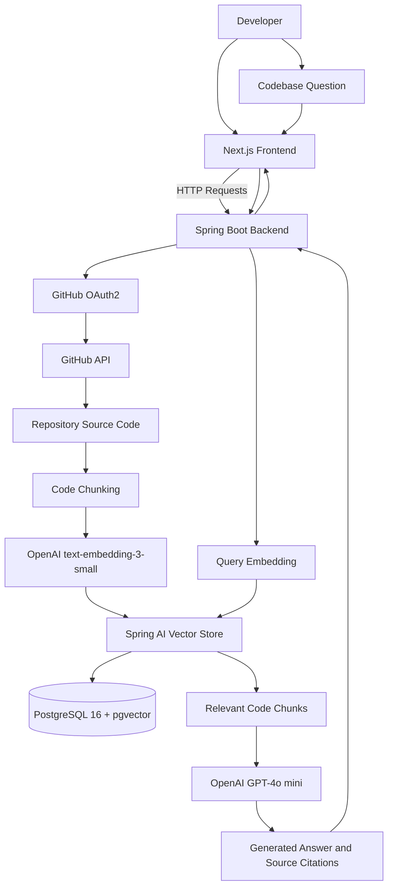

# CodebaseAI

### AI-Powered Codebase Assistant

**CodebaseAI** is an AI-powered developer tool that helps developers understand, explore, and navigate GitHub repositories through natural language conversations.

Built with **Next.js, Spring Boot, PostgreSQL, pgvector, and OpenAI models**, CodebaseAI uses Retrieval-Augmented Generation (RAG) to retrieve relevant source code and generate context-aware answers with source citations.

Connect your GitHub repositories, index your codebase, and ask questions about architecture, business logic, API endpoints, dependencies, and implementation details without manually searching through hundreds of files.

## Table of Contents

- [Overview](#overview)
- [Features](#features)
- [Technology Stack](#technology-stack)
- [Architecture](#architecture)
- [How It Works](#how-it-works)
- [AI and RAG Pipeline](#ai-and-rag-pipeline)
- [Getting Started](#getting-started)
- [Docker and Database Setup](#docker-and-database-setup)
- [Backend Configuration](#backend-configuration)
- [GitHub OAuth Setup](#github-oauth-setup)
- [Running the Application](#running-the-application)
- [Configuration Reference](#configuration-reference)
- [Project Structure](#project-structure)
- [Security Considerations](#security-considerations)
- [Future Enhancements](#future-enhancements)
- [Contributing](#contributing)
- [License](#license)

---

## Overview

Understanding an unfamiliar codebase can be challenging, especially when working with large repositories, complex dependencies, and interconnected modules.

CodebaseAI simplifies code exploration by combining semantic search with large language models.

Instead of relying exclusively on an AI model's pretrained knowledge, CodebaseAI retrieves relevant code from an indexed repository and uses that context to generate answers.

### What You Can Do

- Connect your GitHub account and access authorized repositories.
- Index repository source code for semantic retrieval.
- Ask questions about your codebase using natural language.
- Retrieve relevant code snippets using vector similarity search.
- Generate AI-powered explanations grounded in repository context.
- Navigate to relevant source files through citations.
- Explore unfamiliar projects and understand their implementation.

The goal is to make source code easier to discover, understand, and navigate.

---

## Features

### 1. GitHub Integration

Connect your GitHub account through OAuth2 authentication to access your repositories.

Features include:

- GitHub OAuth2 authentication.
- Repository discovery and listing.
- Repository metadata, including descriptions and default branches.
- Repository visibility indicators.
- Repository selection for indexing.

Access to private repositories depends on the permissions granted to the application.

### 2. Repository Indexing

CodebaseAI processes repository source code and prepares it for semantic search.

The indexing pipeline includes:

- Retrieving repository source files.
- Splitting source code into manageable chunks.
- Generating vector embeddings.
- Storing embeddings and associated metadata.
- Preparing indexed content for retrieval.

The configured indexing settings control the maximum file size, chunk size, and overlap.

### 3. Retrieval-Augmented Generation

CodebaseAI uses Retrieval-Augmented Generation to provide answers grounded in the contents of an indexed repository.

When a user asks a question, the application retrieves semantically relevant code chunks and provides them as context to the language model.

This helps generate repository-specific answers instead of relying solely on general programming knowledge.

### 4. AI-Powered Codebase Chat

Interact with your repository through natural language questions.

Example questions include:

- How does authentication work in this project?
- Explain the overall application architecture.
- Where is database connectivity configured?
- Which classes implement the core business logic?
- How does this API endpoint process requests?
- Explain the interaction between these modules.
- Where is exception handling implemented?
- How does the application retrieve and process data?

### 5. Source Citations

CodebaseAI is designed to provide source references alongside generated answers.

Citations help developers locate relevant implementation details, inspect the underlying code, and verify the explanations provided by the AI model.

### 6. Semantic Code Search

Traditional keyword search depends heavily on exact text matches. Semantic search retrieves content based on the meaning of a query.

For example, asking "Where does the application validate user credentials?" can retrieve relevant authentication code even when the source uses different terminology.

### 7. Full-Stack Architecture

CodebaseAI separates frontend and backend responsibilities.

- **Next.js:** Developer-facing user interface.
- **Spring Boot:** Backend APIs, application logic, and integration workflows.
- **Spring AI:** Integration with OpenAI models and the pgvector vector store.
- **PostgreSQL and pgvector:** Persistent storage and semantic vector search.
- **Docker Compose:** Local database orchestration.

---

## Technology Stack

| Technology | Purpose |
|---|---|
| Next.js | Frontend application |
| React | Component-based user interface |
| TypeScript | Type-safe frontend development |
| Java | Backend development |
| Spring Boot | Backend application and REST APIs |
| Spring Security OAuth2 Client | GitHub OAuth2 integration |
| GitHub API | Repository discovery and source-code access |
| Spring AI | AI model and vector-store integration |
| OpenAI GPT-4o mini | AI-powered question answering |
| OpenAI `text-embedding-3-small` | Source-code and query embeddings |
| PostgreSQL 16 | Relational database |
| pgvector | Vector storage and similarity search |
| Hibernate / Spring Data JPA | Database persistence, where configured |
| Docker Compose | Database container orchestration |
| Maven | Java dependency management, if used |

---

## Architecture

CodebaseAI follows a full-stack architecture that separates the frontend, backend, AI processing, and database layers.

### Frontend: Next.js

The Next.js application provides the user interface for:

- GitHub authentication.
- Repository discovery and selection.
- Repository indexing.
- Codebase conversations.
- Displaying AI-generated answers.
- Navigating source citations.

The frontend communicates with the Spring Boot backend through HTTP requests.

### Backend: Spring Boot

The Spring Boot backend coordinates the application's core workflows.

Its responsibilities include:

- Processing frontend requests.
- Integrating with GitHub APIs.
- Retrieving and processing repository source code.
- Coordinating code indexing.
- Generating embeddings.
- Performing semantic retrieval.
- Calling OpenAI models.
- Returning generated answers and source references.

### AI Layer: OpenAI

CodebaseAI uses two OpenAI models for different tasks.

**GPT-4o mini**

Used for generating natural language answers from the user's question and retrieved source-code context.

**`text-embedding-3-small`**

Used to convert source-code chunks and user questions into vector representations for semantic similarity search.

The configured embedding dimensionality is 1,536.

### Database Layer: PostgreSQL and pgvector

PostgreSQL stores application data and indexed repository information.

The pgvector extension provides vector storage and similarity search capabilities. Spring AI is configured to initialize the vector-store schema automatically.

The application uses an HNSW index and cosine distance for vector similarity search.

### Infrastructure: Docker Compose

Docker Compose runs PostgreSQL 16 with pgvector in a container.

A named Docker volume persists database data across container restarts.

### Architecture Diagram



---

## How It Works

CodebaseAI follows a repository indexing and retrieval workflow.

### Step 1: Connect GitHub

The user authenticates through GitHub OAuth2 and authorizes access to the repositories they want to explore.

### Step 2: Select a Repository

The application retrieves repository metadata and allows the user to select a repository for indexing.

### Step 3: Retrieve Source Code

The backend retrieves supported source files from the selected repository.

### Step 4: Split Code into Chunks

Source files are divided into smaller chunks to make relevant code easier to retrieve.

The configured chunk size is 800, with an overlap of 100. The precise unit depends on the implementation.

### Step 5: Generate Embeddings

The backend uses OpenAI's `text-embedding-3-small` model to convert source-code chunks into embeddings.

Each embedding represents semantic information about its associated code.

### Step 6: Store Embeddings

The embeddings and associated metadata are stored in PostgreSQL through pgvector.

### Step 7: Submit a Question

The user submits a natural language question through the Next.js interface.

### Step 8: Retrieve Relevant Context

The backend generates an embedding for the question and performs vector similarity search against the indexed content.

### Step 9: Generate an Answer

The retrieved code chunks are supplied to GPT-4o mini along with the user's question.

The model generates a response using the supplied repository context.

### Step 10: Return the Answer

The backend returns the generated response and relevant source references to the frontend for display.

---

## AI and RAG Pipeline

The RAG implementation consists of two primary workflows.

### Indexing Pipeline

```text
GitHub Repository
       |
       v
Source Code Retrieval
       |
       v
Code Chunking
       |
       v
OpenAI text-embedding-3-small
       |
       v
Vector Embeddings
       |
       v
PostgreSQL + pgvector
```

### Question-Answering Pipeline

```text
User Question
       |
       v
Query Embedding
       |
       v
Vector Similarity Search
       |
       v
Relevant Code Chunks
       |
       v
Context Preparation
       |
       v
OpenAI GPT-4o mini
       |
       v
Generated Answer + Source Citations
```

### Model Responsibilities

| Model | Input | Output | Purpose |
|---|---|---|---|
| `text-embedding-3-small` | Source-code chunks or user queries | Vector embeddings | Semantic retrieval |
| `gpt-4o-mini` | User question and retrieved context | Natural language response | Code explanations and question answering |

Using separate models for embeddings and response generation separates semantic retrieval from natural language generation.

---

## Getting Started

Follow these instructions to run CodebaseAI locally.

### Prerequisites

Install or configure the following:

- Node.js and npm.
- A JDK compatible with the project's Spring Boot version.
- Maven or the Maven Wrapper included in the repository.
- Docker Desktop or Docker Engine with Docker Compose.
- A GitHub account.
- A GitHub OAuth application.
- An OpenAI API key with access to the required models.

### 1. Clone the Repository

```bash
git clone https://github.com/YOUR_USERNAME/codebaseAI.git
cd codebaseAI
```

Replace `YOUR_USERNAME` with your GitHub username.

### 2. Start PostgreSQL with Docker Compose

The project uses the `pgvector/pgvector:pg16` Docker image.

Start the database:

```bash
docker compose up -d postgres
```

Check the container status:

```bash
docker compose ps
```

Follow the database logs:

```bash
docker compose logs -f postgres
```

Verify that PostgreSQL is ready:

```bash
docker exec devpilot-postgres pg_isready -U postgres -d devpilot
```

The database configuration is:

| Setting | Value |
|---|---|
| Docker image | `pgvector/pgvector:pg16` |
| Container name | `devpilot-postgres` |
| Database name | `devpilot` |
| Database username | `postgres` |
| Host port | `5433` |
| Container port | `5432` |
| Persistent volume | `devpilot_pg_data` |

The database is accessible from the host machine at `localhost:5433`.

### 3. Docker Compose Configuration

The database service uses the following configuration:

```yaml
services:
  postgres:
    image: pgvector/pgvector:pg16
    container_name: devpilot-postgres
    environment:
      POSTGRES_DB: devpilot
      POSTGRES_USER: postgres
      POSTGRES_PASSWORD: postgres
    ports:
      - "5433:5432"
    volumes:
      - devpilot_pg_data:/var/lib/postgresql/data
      - ./docker/postgres/init-extensions.sql:/docker-entrypoint-initdb.d/01-extensions.sql:ro
    healthcheck:
      test: ["CMD-SHELL", "pg_isready -U postgres -d devpilot"]
      interval: 5s
      timeout: 5s
      retries: 5

volumes:
  devpilot_pg_data:
```

The named volume `devpilot_pg_data` preserves database data across container restarts and recreation.

The initialization script is mounted read-only and runs during the initial database setup. If the volume already contains an initialized database, changes to the initialization script will not automatically run again.

For local development, the configured database credentials are:

```text
Database: devpilot
Username: postgres
Password: postgres
Host: localhost
Port: 5433
```

These credentials are for local development and should be replaced with secure credentials in production.

### 4. Configure the Backend

Navigate to the Spring Boot backend directory:

```bash
cd backend
```

The backend uses `application.properties` for database connectivity, OpenAI integration, GitHub OAuth2, session management, vector storage, and application settings.

Set the required environment variables before starting the application.

```bash
export DB_URL="jdbc:postgresql://localhost:5433/devpilot"
export DB_USERNAME="postgres"
export DB_PASSWORD="postgres"

export OPENAI_API_KEY="your_openai_api_key"

export GITHUB_CLIENT_ID="your_github_client_id"
export GITHUB_CLIENT_SECRET="your_github_client_secret"
```

Configure token-encryption settings as appropriate for your environment:

```bash
export TOKEN_ENCRYPTOR_PASSWORD="your_secure_encryption_password"
export TOKEN_ENCRYPTOR_SALT="your_secure_encryption_salt"
```

Use secure values for production deployments and never commit secrets to version control.

### 5. Configure GitHub OAuth2

Create a GitHub OAuth application and configure the callback URL expected by the Spring Security OAuth2 client.

The backend requests these scopes:

```text
read:user
repo
```

The `read:user` scope allows the application to retrieve authenticated user profile information. The `repo` scope enables repository access according to the permissions granted by GitHub.

The actual callback URL must match the redirect URI configured in your Spring Security OAuth2 setup.

For setup details, see the [GitHub OAuth documentation](https://docs.github.com/en/apps/oauth-apps/building-oauth-apps/creating-an-oauth-app).

### 6. Configure OpenAI

CodebaseAI uses two OpenAI models:

| Model | Purpose |
|---|---|
| `gpt-4o-mini` | AI-powered codebase question answering |
| `text-embedding-3-small` | Semantic embeddings for source code and queries |

Set your OpenAI API key through the `OPENAI_API_KEY` environment variable.

The backend uses Spring AI's OpenAI integration. Ensure that your Spring AI version supports the configured models and property names.

The following are the standard model option properties used by compatible Spring AI versions:

```properties
spring.ai.openai.chat.options.model=gpt-4o-mini
spring.ai.openai.embedding.options.model=text-embedding-3-small
```

The vector-store dimensions must match the embedding model's output dimensions.

### 7. Start the Spring Boot Backend

From the directory containing the backend's `pom.xml`, run:

```bash
./mvnw spring-boot:run
```

Alternatively, if Maven is installed:

```bash
mvn spring-boot:run
```

Ensure that PostgreSQL is running and the required environment variables are configured before starting the backend.

### 8. Start the Next.js Frontend

Open another terminal and navigate to the frontend directory:

```bash
cd client
```

Install dependencies:

```bash
npm install
```

Start the development server:

```bash
npm run dev
```

Open the application:

**http://localhost:3000**

Ensure that the frontend's API configuration points to the correct Spring Boot backend URL.

### 9. Use CodebaseAI

Once the frontend, backend, and database are running:

1. Open CodebaseAI in your browser.
2. Authenticate with GitHub.
3. Select an accessible repository.
4. Start the repository indexing process.
5. Wait for indexing to complete.
6. Ask questions about the indexed codebase.
7. Review the AI-generated answers and source citations.

---

## Backend Configuration

The following configuration documents the settings used by the application.

### Database Configuration

```properties
spring.datasource.url=${DB_URL:jdbc:postgresql://localhost:5433/devpilot}
spring.datasource.username=${DB_USERNAME:postgres}
spring.datasource.password=${DB_PASSWORD:postgres}
spring.datasource.driver-class-name=org.postgresql.Driver

spring.jpa.hibernate.ddl-auto=update
spring.jpa.show-sql=false
spring.jpa.properties.hibernate.format_sql=true
spring.jpa.open-in-view=false
```

These properties configure the PostgreSQL connection and Hibernate persistence behavior.

### OpenAI Configuration

```properties
spring.ai.openai.api-key=${OPENAI_API_KEY}
spring.ai.openai.chat.options.model=gpt-4o-mini
spring.ai.openai.embedding.options.model=text-embedding-3-small
```

Use the model property names supported by the Spring AI version declared in the project's dependencies.

### GitHub OAuth2 Configuration

```properties
spring.security.oauth2.client.registration.github.client-id=${GITHUB_CLIENT_ID}
spring.security.oauth2.client.registration.github.client-secret=${GITHUB_CLIENT_SECRET}
spring.security.oauth2.client.registration.github.scope=read:user,repo
spring.security.oauth2.client.provider.github.user-name-attribute=id
```

These properties configure GitHub OAuth2 client registration.

### Session Cookie Configuration

```properties
server.servlet.session.cookie.name=DEVPILOT_SESSION
server.servlet.session.cookie.http-only=true
server.servlet.session.cookie.same-site=lax
server.servlet.session.timeout=7d
```

These settings configure the session cookie name, HTTP-only behavior, SameSite policy, and session timeout.

The session cookie name can remain `DEVPILOT_SESSION` even though the product is named CodebaseAI. Rename it if you want consistent naming across the application.

### Vector Store Configuration

```properties
spring.ai.vectorstore.pgvector.initialize-schema=true
spring.ai.vectorstore.pgvector.dimensions=1536
spring.ai.vectorstore.pgvector.index-type=HNSW
spring.ai.vectorstore.pgvector.distance-type=COSINE_DISTANCE
```

These settings configure:

- Automatic vector-store schema initialization.
- A vector dimension of 1,536.
- An HNSW vector index.
- Cosine distance for similarity calculations.

### Application Configuration

```properties
app.frontend-url=${FRONTEND_URL:http://localhost:3000}
app.cors.allowed-origins=${CORS_ALLOWED_ORIGINS:http://localhost:3000}

app.token-encryptor-password=${TOKEN_ENCRYPTOR_PASSWORD}
app.token-encryptor-salt=${TOKEN_ENCRYPTOR_SALT}

app.indexing.max-file-bytes=102400
app.indexing.chunk-size=800
app.indexing.chunk-overlap=100

app.github.api-delay-ms=50
```

These settings control frontend integration, allowed CORS origins, token encryption, repository indexing, and the configured GitHub API delay.

The units for `chunk-size` and `chunk-overlap` depend on the indexing implementation.

---

## Configuration Reference

| Variable or Property | Purpose | Default |
|---|---|---|
| `DB_URL` | PostgreSQL JDBC connection URL | `jdbc:postgresql://localhost:5433/devpilot` |
| `DB_USERNAME` | Database username | `postgres` |
| `DB_PASSWORD` | Database password | `postgres` |
| `OPENAI_API_KEY` | OpenAI API authentication | Must be configured |
| `GITHUB_CLIENT_ID` | GitHub OAuth2 client ID | Must be configured |
| `GITHUB_CLIENT_SECRET` | GitHub OAuth2 client secret | Must be configured |
| `FRONTEND_URL` | Frontend base URL | `http://localhost:3000` |
| `CORS_ALLOWED_ORIGINS` | Allowed frontend origins | `http://localhost:3000` |
| `TOKEN_ENCRYPTOR_PASSWORD` | Token encryption password | Must be configured securely |
| `TOKEN_ENCRYPTOR_SALT` | Token encryption salt | Must be configured securely |
| `app.indexing.max-file-bytes` | Maximum indexed file size | `102400` bytes |
| `app.indexing.chunk-size` | Configured chunk size | `800` |
| `app.indexing.chunk-overlap` | Configured chunk overlap | `100` |
| `app.github.api-delay-ms` | Configured GitHub API delay | `50` milliseconds |

The environment variable defaults shown above reflect the local development configuration. Production deployments should use secure credentials and explicitly configure the required settings.

---


### Directory Responsibilities

| Directory | Responsibility |
|---|---|
| `client/app/` | Next.js routes, pages, and layouts |
| `client/components/` | Reusable UI components |
| `client/lib/` | Frontend utilities and shared logic |
| `backend/src/main/java/` | Spring Boot application code |
| `backend/src/main/resources/` | Backend configuration and resources |
| `backend/src/test/` | Backend tests |
| `docker/postgres/` | PostgreSQL initialization scripts |
| `docker-compose.yml` | Local database orchestration |

The structure is representative and should be adjusted to reflect the actual files and directories in the repository.

---

## Security Considerations

- Store OpenAI API keys and GitHub OAuth secrets in environment variables or a secrets manager.
- Replace default database credentials before production deployment.
- Use strong token-encryption settings and protect encryption secrets.
- Restrict repository access according to the authenticated user's permissions.
- Configure production CORS origins explicitly.
- Use HTTPS for production traffic.
- Protect session cookies and backend APIs.
- Avoid logging access tokens, API keys, or sensitive repository content.
- Ensure that users can retrieve only repository content they are authorized to access.

---

## Future Enhancements

Potential areas for further development include:

- **Incremental Indexing:** Re-index only files that have changed.
- **Branch-Aware Search:** Index and query specific Git branches.
- **Hybrid Search:** Combine keyword search with semantic retrieval.
- **Code-Aware Chunking:** Preserve class, method, and function boundaries.
- **Streaming Responses:** Display generated answers incrementally.
- **Conversation History:** Support contextual follow-up questions.
- **Retrieval Reranking:** Improve the relevance of retrieved code chunks.
- **Repository Synchronization:** Keep indexed content synchronized with GitHub changes.
- **Evaluation Framework:** Measure retrieval relevance, answer quality, and citation accuracy.

These are potential enhancements, not claims about existing functionality.

---

## Contributing

Contributions that improve indexing, retrieval quality, backend architecture, and developer experience are welcome.

1. Fork the repository.
2. Create a feature branch.
3. Implement your changes.
4. Run the available tests and checks.
5. Commit your changes with a descriptive message.
6. Open a pull request describing the changes.

For larger contributions, include the problem being addressed, the proposed solution, and relevant architectural considerations.

---

## License

Choose an appropriate open-source license and add the corresponding `LICENSE` file to the repository.

Until a license is added, do not assume that the project is available for unrestricted reuse or redistribution.

---

## Project Goals

CodebaseAI demonstrates how modern full-stack development, vector databases, and large language models can be combined to create an AI-powered developer assistant.

By connecting GitHub repositories with a RAG pipeline, CodebaseAI helps developers explore source code, understand implementation details, and navigate unfamiliar projects through natural language.

**CodebaseAI: Understand your codebase through conversation.**